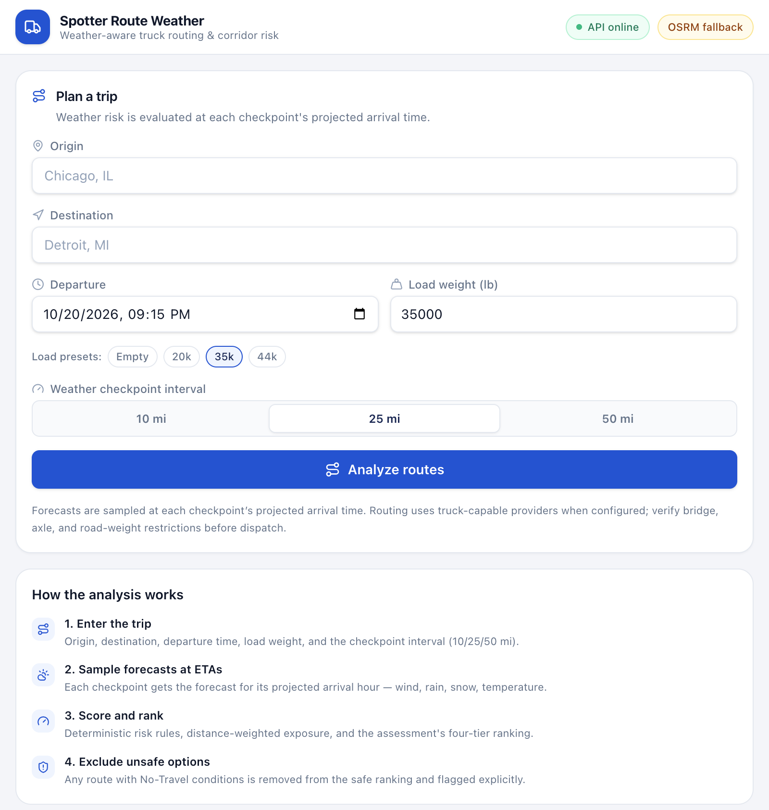
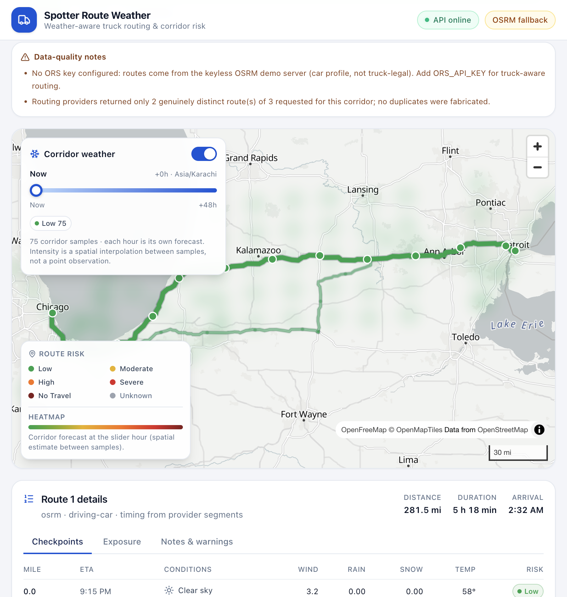

# Spotter Route Weather — Weather-Aware Truck Routing

A full-stack trip planner that helps truck drivers choose the safest route based on **forecast weather at the time they will actually be driving**, cargo weight, departure time, and route duration.

Given an origin, destination, departure time, load weight, and a 10/25/50-mile checkpoint interval, the backend:

1. geocodes both ends,
2. retrieves up to **three genuinely distinct** route alternatives,
3. places weather checkpoints along each route at exact cumulative-mile intervals,
4. computes each checkpoint's ETA from the router's own segment timings,
5. fetches the forecast **for that ETA** (not "now"),
6. applies the assessment's deterministic wind / rain / snow / load risk rules,
7. aggregates **distance-weighted exposure** per route, and
8. recommends a route using the required priority order — with No-Travel routes excluded from the safe ranking.

The UI adds an interactive MapLibre map (risk-colored route segments, checkpoint popups, recommendation highlighting) and a **0–48 hour corridor weather heatmap** with a synchronized forecast slider.





---

## Contents

- [Feature highlights](#feature-highlights)
- [Architecture](#architecture)
- [Technology stack](#technology-stack)
- [Quick start](#quick-start)
- [Configuration](#configuration)
- [API](#api)
- [Testing](#testing)
- [Docker](#docker)
- [Deployment](#deployment)
- [Project structure](#project-structure)
- [Key design decisions](#key-design-decisions)
- [Assumptions & limitations](#assumptions--limitations)
- [Documentation](#documentation)

---

## Feature highlights

**Trip planning & routing**
- Origin/destination autocomplete (debounced Nominatim, cached server-side)
- Departure date-time (timezone-aware), load weight (0–80,000 lb), checkpoint interval 10/25/50 mi
- Up to 3 distinct alternatives via ORS `driving-hgv` (`alternative_routes`), with GraphHopper and a keyless OSRM fallback
- Near-duplicate geometries are collapsed; the API never fabricates "alternatives"
- Per-step provider timings (ORS steps / OSRM annotations) drive checkpoint ETAs — constant speed only as a documented last resort
- Explicit data-quality warnings when fewer than 3 genuinely distinct routes exist

**Weather**
- Open-Meteo hourly forecasts, batched across all checkpoints in one call
- Rain and snowfall kept separate (never mislabeled mixed precipitation)
- Units normalized (`mph`, `in/hr`, `°F`), snowfall converted defensively from provider units
- Forecast selected/interpolated at each checkpoint ETA; outside the horizon → **UNKNOWN**, never LOW

**Risk & recommendation**
- Exact PDF rules with documented boundary conventions, centralized in one engine
- All three load-dependent wind overrides (including 55 mph No-Travel for every load)
- Highest severity across wind/rain/snow/load wins; No-Travel is a distinct level (4)
- Interval-based, distance-weighted exposure (miles conserved when interval changes)
- Ranking: fewest Severe miles → fewest High miles → lowest average risk → shortest travel time
- Safety exclusion for No-Travel; if every route is unsafe, no route is declared safe and a least-exposure comparison is shown

**Map & heatmap**
- All alternatives drawn, recommended highlighted, selected route emphasized
- Risk-colored segments, checkpoint markers, click popups with ETA weather
- Auto fit bounds, map legend, zoom/scale controls
- 0–48 h corridor heatmap with per-hour forecast slices (each hour uses its own timestamp)
- Spatial interpolation is explicitly labeled as an estimate in the UI
- Lazy-loaded map chunk; memoized GeoJSON; MapLibre source updates without layer churn

**Engineering**
- 130 backend tests (risk boundaries, load rules, interpolation, ETA, units, failures, ranking, API contracts)
- 31 frontend tests (form validation, route cards, recommendation states, heatmap slider behavior)
- Typed provider adapters, structured API envelope, cached/rate-limited outbound calls
- Docker Compose, Render + Vercel deployment configuration, environment templates

---

## Architecture

```
Browser (React 19 + TS + Vite + Tailwind + MapLibre)
   │  POST /api/routes/analyze/         GET /api/weather/corridor/
   ▼
Django 6 + DRF  (api/ — serializers, views, envelope, error handler)
   ▼
services/analysis/pipeline.py  (orchestration)
   ├── services/geocoding  → Nominatim (1 req/s throttle, 24 h cache)
   ├── services/routing    → ORS driving-hgv (alternatives) → GraphHopper → OSRM
   ├── services/analysis   → checkpoint sampling + ETA interpolation
   ├── services/weather    → Open-Meteo batched multi-location forecasts
   ├── services/risk       → deterministic wind/rain/snow/load rules
   └── services/recommendation → distance-weighted exposure + ranking
```

Every outbound provider call lives inside a dedicated adapter; domain services never know provider payload shapes. The analyze response is persisted briefly in cache so the heatmap endpoint can regenerate the corridor without re-routing.

---

## Technology stack

| Layer | Choice |
|---|---|
| Frontend | React 19, TypeScript 5.9, Vite 8, Tailwind CSS 4, MapLibre GL JS 6, TanStack Query 5, React Hook Form 7 + Zod 4, lucide-react |
| Backend | Python 3.13+, Django 6.1, Django REST Framework 3.18, django-cors-headers, HTTPX |
| Routing | OpenRouteService `driving-hgv` (optional key, up to 3 alternatives), GraphHopper (optional), OSRM public server (keyless fallback) |
| Weather | Open-Meteo forecast API (free, no key; up to 16 days hourly) |
| Geocoding | OpenStreetMap Nominatim (free, no key; 1 req/s policy) |
| Tiles | OpenFreeMap vector tiles (free, no key) |
| Tests | pytest + pytest-django + respx; Vitest + Testing Library + jsdom |

---

## Quick start

**Prerequisites:** Python 3.12+ (3.13/3.14 tested), Node 20.19+ (22/23 tested), npm.

### Backend

```bash
cd backend
python3 -m venv .venv
source .venv/bin/activate
pip install -r requirements-dev.txt   # runtime + test tooling
cp ../.env.example .env          # optional: add ORS_API_KEY
python manage.py migrate         # applies Django's built-in migrations (no app models)
python manage.py check
python manage.py runserver 8000
```

The API is now at `http://localhost:8000` (health: `/api/health/`).

### Frontend

```bash
cd frontend
npm install
npm run dev
```

Open `http://localhost:5173`. Vite proxies `/api` to `http://localhost:8000`, so no CORS setup is needed in development.

> **No API key is strictly required.** Without `ORS_API_KEY` the app uses the keyless OSRM demo server (car profile) and shows a clear warning that routes are not truck-legal. With a free ORS key it uses the truck-aware `driving-hgv` profile and requests 3 alternatives.

### Getting an ORS key (recommended, free)

1. Sign up at <https://openrouteservice.org/dev/#/signup>.
2. Create a token, then set `ORS_API_KEY=...` in `backend/.env`.
3. Restart the backend. `/api/health/` will report `openrouteservice: true` and the UI badge changes to **Truck routing (ORS hgv)**.

---

## Configuration

All settings are environment-driven (see [`.env.example`](.env.example)).

| Variable | Default | Purpose |
|---|---|---|
| `DJANGO_SETTINGS_MODULE` | `config.settings.dev` | `dev` / `test` / `prod` |
| `DJANGO_SECRET_KEY` | dev placeholder | **Required in prod**; startup fails without it |
| `DJANGO_ALLOWED_HOSTS` | `localhost,127.0.0.1` | Comma-separated |
| `CORS_ALLOWED_ORIGINS` | `http://localhost:5173` | Browser origins allowed to call the API |
| `APP_USER_AGENT` | `spotter-weather-routing/1.0 (assessment)` | Required by Nominatim; set a real contact for public deployments |
| `ORS_API_KEY` | empty | Enables truck-aware routing + alternatives |
| `GRAPHHOPPER_API_KEY` | empty | Optional tertiary routing fallback |
| `OSRM_BASE_URL` | public demo | Keyless routing fallback |
| `OPEN_METEO_BASE_URL` | public API | Weather provider |
| `NOMINATIM_BASE_URL` | public API | Geocoding provider |
| `*_CACHE_TTL` | 24 h / 1 h / 30 min / 6 h | Geocode / route / weather / analysis cache |
| `REDIS_URL` | unset | Use Redis cache instead of LocMem (multi-worker deployments) |
| `VITE_API_BASE_URL` | empty | Frontend API origin (empty = same-origin/proxy) |
| `VITE_PROXY_TARGET` | `http://localhost:8000` | Dev proxy target |

---

## API

All responses use one envelope:

```json
{ "data": { ... }, "warnings": ["..."], "meta": { ... } }
```

Errors:

```json
{ "error": { "code": "geocode_not_found", "detail": "…", "fields": { "origin": "…" } } }
```

### `POST /api/routes/analyze/`

```json
{
  "origin": "Chicago, IL",
  "destination": "Detroit, MI",
  "departure_time": "2026-10-22T08:00:00-05:00",
  "load_weight_lbs": 35000,
  "checkpoint_interval_miles": 25
}
```

Returns (abridged):

```json
{
  "data": {
    "analysis_id": "96df86e7…",
    "request": { "origin": { "resolved": "Chicago, …" }, "destination": { "…": "…" } },
    "routes": [
      {
        "id": "route-1",
        "provider": "openrouteservice",
        "profile": "driving-hgv",
        "distance_miles": 281.5,
        "duration_minutes": 317.9,
        "arrival_time": "2026-10-22T13:02:00Z",
        "checkpoints": [
          {
            "index": 1, "mile": 25.0, "coordinates": [-87.4, 41.7],
            "eta": "2026-10-22T13:25:00Z",
            "weather": { "available": true, "wind_mph": 12.4, "rain_in_hr": 0.02, "snow_in_hr": 0.0,
                         "temperature_f": 58.1, "condition": "Overcast", "source": "open-meteo" },
            "risk": { "available": true, "level": "MODERATE", "score": 1,
                      "contributions": { "wind": "LOW", "rain": "MODERATE", "snow": "LOW" },
                      "load_rule_applied": null, "complete": true }
          }
        ],
        "segments": [ { "from_mile": 0, "to_mile": 25, "level": "MODERATE", "coordinates": [[…]] } ],
        "exposure": { "low_miles": 240.1, "moderate_miles": 41.4, "high_miles": 0, "severe_miles": 0,
                      "no_travel_miles": 0, "unassessed_miles": 0, "total_miles": 281.5,
                      "average_risk": 0.147, "max_risk": "MODERATE", "unassessed_share": 0 }
      }
    ],
    "recommendation": {
      "recommended_route_id": "route-1",
      "reason": "Recommended because this route avoids severe weather; …",
      "eligible": true, "ranking": ["route-1", "route-2"],
      "least_exposed_route_id": null
    },
    "warnings": ["…"]
  },
  "warnings": ["…"],
  "meta": { "route_count": 2, "providers": { "routing": ["openrouteservice"] } }
}
```

### `GET /api/weather/corridor/?analysis_id=…&route_id=route-1`

Returns the 0–48 h heatmap lattice for a cached analysis: `hours` (49 ISO timestamps), `points[]` with `severity_by_hour[]` and `values_by_hour[]`, plus notes clarifying spatial interpolation. Analyses expire after 6 h; re-run analyze if you get `analysis_not_found`.

### `GET /api/geocode/suggest/?q=chicag`

Debounced autocomplete, cached 24 h.

### `GET /api/health/`

Provider configuration and timestamp, used by the header status chip.

---

## Testing

### Backend

```bash
cd backend
source .venv/bin/activate
pytest
```

**130 tests** cover:

- every wind/rain/snow boundary value (including shared endpoints),
- all three load-dependent wind rules and their strict `>` boundaries,
- highest-severity selection and No-Travel ≠ Severe,
- checkpoint placement, interpolation, and ETA from provider timing,
- weather unit conversion (cm→in, °C→°F, hourly sum→intensity),
- forecast timestamp matching, interpolation, and out-of-horizon handling,
- distance-weighted exposure + interval-independence (miles conserved),
- recommendation priority order, No-Travel exclusion, all-unsafe behavior,
- routing/weather/geocoding failures and fallback chains,
- fewer-than-three-route degradation,
- API validation, error envelopes, corridor endpoint, and health.

All provider calls are mocked with **realistic static fixtures** (`backend/tests/fixtures/`). Fixtures are used only by tests — the production UI always labels live data with its source and never shows fixture data.

### Frontend

```bash
cd frontend
npm test          # Vitest + Testing Library
npm run lint
npx tsc --noEmit
npm run build
```

**31 tests** cover form validation/errors, presets, route cards and recommendation states, risk colors/legend data, heatmap slider semantics, map GeoJSON builders, and formatter utilities.

---

## Docker

```bash
cp .env.example .env      # optionally set ORS_API_KEY
docker compose up --build
```

- Frontend: <http://localhost:8080> (nginx serves the SPA and proxies `/api` to the backend)
- Backend: <http://localhost:8000> (gunicorn, production settings)
- Redis: shared cache for the backend

The map needs internet access at runtime for OpenFreeMap tiles, Open-Meteo, Nominatim, and routing providers.

---

## Deployment

### Backend → Render

1. Push the repo to GitHub.
2. In Render, create a **Blueprint** from the repo (`render.yaml` is included) or a Docker web service with context `backend/`.
3. Set `CORS_ALLOWED_ORIGINS` to your Vercel domain and add `ORS_API_KEY` as a secret.
4. Render generates `DJANGO_SECRET_KEY`; the service exposes `/api/health/` for health checks.

### Frontend → Vercel

1. Import the repo; set the project root to `frontend/`.
2. Set `VITE_API_BASE_URL=https://<your-render-service>.onrender.com`.
3. `vercel.json` already defines the Vite build and SPA rewrite.

### CORS checklist

- `CORS_ALLOWED_ORIGINS` must include the exact frontend origin(s), including `https://`.
- `DJANGO_ALLOWED_HOSTS` must include the Render hostname (`.onrender.com` covers subdomains).
- Never commit `.env` or API keys.

> Publishing to GitHub, hosting, and recording a walkthrough are manual steps for the submitter; this repository contains everything needed, but no deployment is claimed to have been performed.

---

## Project structure

```
spotter-weather-routing/
├── backend/
│   ├── api/                     # DRF views, serializers, envelope, errors, urls
│   ├── config/                  # settings (base/dev/test/prod), urls, wsgi/asgi
│   ├── services/
│   │   ├── analysis/            # pipeline, checkpoint sampling, corridor service
│   │   ├── geo/                 # geometry, interpolation, polyline, corridor lattice
│   │   ├── geocoding/           # Nominatim adapter (throttled + cached)
│   │   ├── routing/             # ORS / GraphHopper / OSRM adapters + fallback chain
│   │   ├── weather/             # Open-Meteo adapter + ETA selection/interpolation
│   │   ├── risk/                # severity enum + deterministic rules engine
│   │   └── recommendation/      # exposure aggregation + ranking/explanations
│   ├── tests/                   # 130 tests + static provider fixtures
│   └── Dockerfile
├── frontend/
│   ├── src/
│   │   ├── components/          # shared UI primitives
│   │   ├── features/
│   │   │   ├── trip-planner/    # form, schema, autocomplete
│   │   │   ├── route-comparison/# cards, recommendation banner, details, risk bar
│   │   │   ├── map/             # MapLibre map, legend, popup
│   │   │   └── weather/         # corridor heatmap panel + slider
│   │   ├── hooks/ lib/ test/    # queries, API client, formatters, risk utilities
│   │   └── types.ts
│   ├── Dockerfile / nginx.conf / vercel.json
├── docs/                        # architecture, walkthrough, requirements checklist
├── docker-compose.yml
├── render.yaml
├── .env.example
└── README.md
```

---

## Key design decisions

**Boundary convention.** The PDF's bands share endpoints. Every band is treated as lower-inclusive, so a value exactly on a boundary maps to the more severe band (wind 25 → Moderate, 35 → High, 45 → Severe, 55 → No-Travel; rain 0.10 → Moderate, 0.25 → High, 0.50 → Severe; snow 0.50 → Moderate, 1.00 → High, 2.00 → Severe). Rain 1.00 and snow 3.00 remain Severe because the PDF says **>**1.00 / **>**3.00 for No-Travel. Every endpoint is tested.

**Exposure is interval-based, not checkpoint-count-based.** The miles between consecutive checkpoints are attributed to the higher endpoint severity. Per-level miles plus unassessed miles always sum to the route distance, regardless of 10/25/50-mile sampling.

**UNKNOWN is never LOW.** Missing/out-of-horizon forecasts produce `available: false` and unassessed miles; they are excluded from risk averages and flagged, so an incompletely assessed route is never presented as confidently safe.

**No-Travel is a safety exclusion.** Routes with No-Travel exposure cannot be recommended. If all routes are unsafe, the response returns no recommendation, explains the conflict, and provides a clearly marked least-exposure comparison instead.

**Alternatives must be genuine.** Providers may return fewer than three distinct routes (documented ORS/OSRM behavior, especially on long corridors). The API deduplicates by geometry similarity and warns instead of duplicating a route.

**Heatmap time semantics.** The slider is anchored at "now" (0–48 h lead time). Each position uses the forecast for its own timestamp — never one fixed timestamp reused. This is deliberately separate from checkpoint ETA weather, which drives route risk.

See [docs/architecture.md](docs/architecture.md) for the full design and math.

---

## Assumptions & limitations

- **Truck legality:** routes are truck-aware only when configured with ORS `driving-hgv` (or a comparable truck profile). Bridge clearance, axle limits, and posted road-weight restrictions must still be verified by dispatch. Without an ORS key the app uses OSRM's car profile and says so.
- **Routing alternatives:** ORS does not guarantee 3 alternatives for every corridor; OSRM's demo server is best-effort and rate-limited. The UI shows only genuinely distinct routes and warns when fewer are available.
- **Public services:** Nominatim (1 req/s), Open-Meteo, OSRM demo, and OpenFreeMap are free public services without SLA. Caching, batching, and a single throttled geocoder protect them; production deployments should use commercial endpoints/keys.
- **Forecast horizon:** weather is available up to 16 days; trips beyond that are marked UNKNOWN. The heatmap covers the next 48 hours.
- **Interpolation:** values between forecast hours and between corridor sample points are estimates; the UI labels the heatmap as a spatial interpolation.
- **No authentication or persistence:** the assessment focuses on routing/weather analysis. Analyses are cached briefly; there are no user accounts or saved trips.
- **Fixture data:** static provider fixtures exist only under `backend/tests/` and are never served by the API or shown in the UI.

---

## Documentation

- [Architecture & algorithms](docs/architecture.md) — routing, checkpoints, ETA, weather selection, risk rules, exposure, ranking, heatmap, caching.
- [Walkthrough script](docs/walkthrough.md) — a 5–10 minute Loom demo plan.
- [Requirements checklist](docs/requirements-checklist.md) — requirement-by-requirement mapping with verification.

## Data attribution

Weather: [Open-Meteo](https://open-meteo.com/) · Geocoding: [OpenStreetMap Nominatim](https://nominatim.org/) · Routing: [OpenRouteService](https://openrouteservice.org/) / [GraphHopper](https://www.graphhopper.com/) / [OSRM](http://project-osrm.org/) · Tiles: [OpenFreeMap](https://openfreemap.org/) © OpenMapTiles, data © OpenStreetMap contributors.
